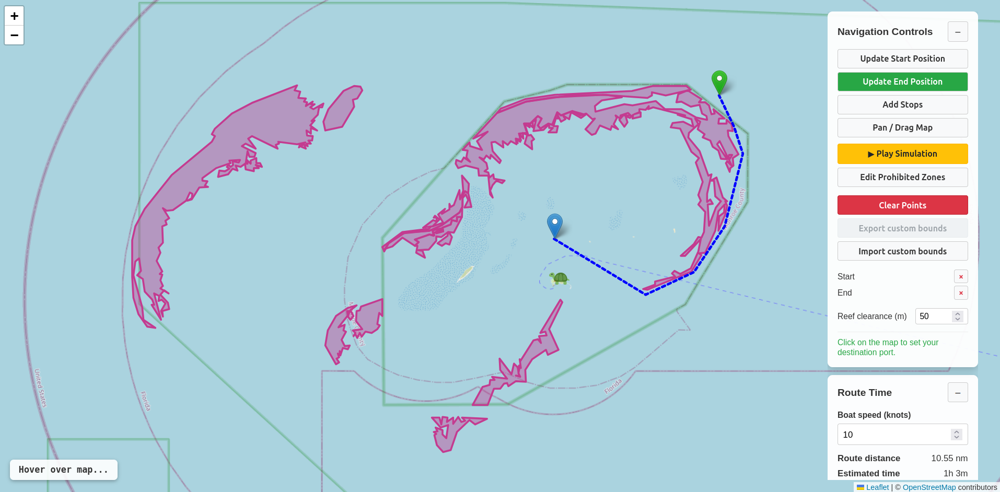

---

## What inspired us
The Inspiration for ReefRoute is to help prevent damage to our local coral reefs by helping boaters safely navigate these unseen, but delicate ecosystems. We wanted to make a project where the idea could make an impact in the real world and help boaters better plan their routes and traverse them to their desired locations.

## What it does
ReefRoute allows the user to select a starting point and a desired destination. The application then plots the shortest path to the destination that avoids land, restricted/protected waters, and of course, coral reefs. The user can then simulate their boat traversing the path.
The biggest goal of the application is to provide boaters with a tool for better planning and raise awareness of our beautiful Florida coral reefs.

## How we built it
This application was built using Node.JS and Javascript.
Gemini was a tool that was heavy used to assist in code generation and debugging.
We implemented many parts of the react-leaflet library for building the maps in out application.
The application then uses a grid system and longitude and latitude coordinates to collect a start and end location from the user.
We then implemented an A-star algorithm (treating the map like a grid) to efficiently preform the path finding from point A to point B while avoiding obstacles. Which uses Dijkstra's algorithm to look at the distance that has been traveled at any given point and a Greedy-best-first-search to estimate how much distance is left to reach the goal.
The path is then displayed over the map to the user, where the user can then choose to play the simulation of the boat traversing the route.
Everything was written in JavaScript in order to keep the tech stack simple.

## Challenges we ran into
A challenge we faced was getting the animation to work properly as well as balancing the grid square size for accuracy and computational efficiency. If each grid was too small too many calculations would be preformed during the A-star algorithm and the application would be very slow, but if they were too big we would loose accuracy and the path would clip through the edges of obstacles go around them by a large margin them and choose a less efficient path than was possible.

## Accomplishments that we're proud of
We are very proud of what we were able to accomplish with the time we were given. We are also particularly proud of our implementation of the A-star algorithm in JavaScript.
Most of all we are proud of ourselves for working together to lean new things and build a cool project.

## What we learned
We learned how to use the react-leaflet library in JavaScript to generate and place polygons on the map to designate obstacles. This was a tool that no one on the team had any experience with.
We also all learned more about Node.JS and JavaScript development best practices, such as: npm can be very dangerous since it has a lot of compromised and malware containing packages. So, we learned to containerize Node.JS in a docker Dev-container to protect our computers from potential infection, and provide a consistent development environment across all of our computers.

## What's next for ReefRoute
The next features we would like to add to ReefRoute would be to expand the mapping beyond our limited testing area. We would like to add more real world reefs to expand our data and our applications usability outside the Port of Miami area. For this project we focused on that spot for testing purposes and even that small area is incomplete. We would like to implement a system to automatically add land and reef markers so that no human would need to manually add and update them.  
In the mean time a more attainable goal would be to allow the user to add their own markers and then maybe even use the data that each user enters to further map and enhance our application. This could possibly even allow more up to date maps and markers then using an automated system that relies on stored data to be updated. It would allow every user to interact with the application and contribute to it and breath life into it and allow it to adapt and grow as fast as our beautiful Earth does.

## Submission categories:  
    - Full Sail: Pathways & Perception, A Serious Games & Simulation Challenge
    - OneEthos: Innovation for Good
